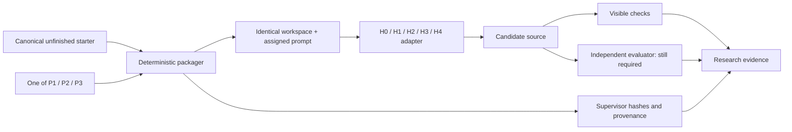

# T01 — Quest browser

This is the first canonical task in the ladder, not the later T02 quest-acceptance task. `starter/` is the identical unfinished application for all conditions. `prompts/` contains three product briefs and one shared mechanical envelope. `requirements.json` records draft information exposure, including rules disclosed by visible tests.

Build an agent input outside the research repository:

```sh
python3 scripts/package_benchmark.py --level P1 --output /tmp/guild-t01-p1
```

The output contains `workspace/`, `prompt.txt`, a deterministic `starter.tar.gz` and `manifest.json`. Supply only workspace and prompt to a harness; retain the manifest and archive as supervisor evidence. The manifest includes per-file SHA-256, archive hash, prompt hash and source revision/dirty status. All prompt levels have the same starter hash. No harness rules, research target, reference implementation or evaluator are included.

Run `make up`, `make test-startup`, `make test-visible` inside the workspace. Startup is green; assigned feature checks are red by design. Validate local mechanics with `python3 scripts/tests/test_benchmark_package.py` and `python3 scripts/verify_t01.py --output /tmp/t01-validation`; the latter uses Docker, creates temporary reference/mutant workspaces and tears down its containers. It makes no model calls. Build downloads require network; dependencies are cached in application images, not installed inside isolated agent workers.

The [shared T01 worker tools](../../containers/t01/README.md) now run visible checks inside all five mock harnesses and retest exported source on a trusted internal-only service network. Run `python3 -B scripts/t01_harness_smoke.py --build --output /tmp/t01-all-harnesses` after the pinned source preparation step documented there. These checks establish offline wiring, not live benchmark readiness. An independent full-target evaluator, complete disclosure audit, image digest freeze, budget and runtime admission are still required before paid runs. Visible component tests do not prove real-browser keyboard behavior or all P3 semantics. No benchmark score should be reported from them alone.



See [harness alignment](harness-alignment.md) for exact adapter status and [local verification receipt](verification.json) for hashes and observed checks. The new `benchmark-starter.yml` workflow repeats packaging, startup, red/green and defect-detection checks without provider credentials. Each GitHub run retains its own verification summary and logs as artifacts; `verification.json` records the earlier local validation.
