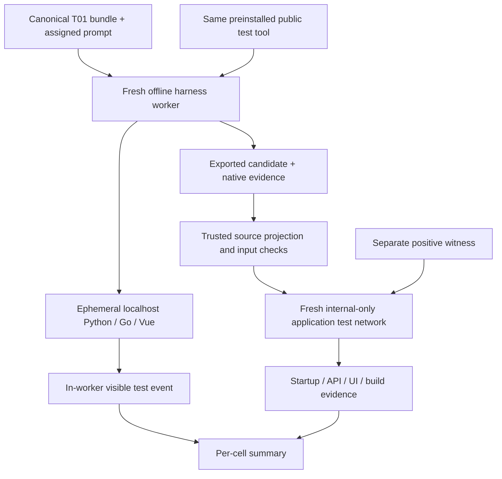

# Shared T01 offline tools and mock integration

Run from the research repository after preparing the pinned packages/source exports:

```sh
python3 -B scripts/offline_harness_ci.py prepare
python3 -B scripts/t01_harness_smoke.py --build --output /tmp/t01-all-harnesses
```

The default is all 15 combinations: P1/P2/P3 × H0/H1/H2/H3/H4. `--levels P1` provides a shorter wiring check. Outputs must be new directories. Builds download public dependencies; execution makes no model calls. This command does not commit or publish anything.

Three dedicated worker images share the same installed public test tool and locked application dependencies. No model CLI is installed. H0/H1/H2 use the Claude fake runtime; H3 copies the pinned native Loom binary; H4 copies the pinned Harness² Python source. Original standalone smoke images and package bytes remain separate. The image IDs used in each run are recorded and tags are resolved once. `profile.json` explicitly identifies these mock overlays, binds their adapter/tool hashes and cites the unchanged source profiles; the worker image labels must match its hash. The T01 Harness² adapter is an additional boundary, not a relabeling of the original ledger-demo entrypoint.

The common task envelope names the same command for every harness. Every worker can run:

```sh
python3 /opt/t01/visible_checks.py
```

The tool starts Python, Go and Vue servers inside that worker's isolated localhost namespace, runs the supplied startup/API/UI checks and TypeScript/production build, and stops its servers. Dependencies are already installed; no Docker socket, registry access, host ports or model credentials are supplied. Its scratch volume is executable for Node's native build dependencies, with a read-only root filesystem and no external network. The tool emits a JSON event with real command exits and logs. The normal command exits nonzero when visible features fail. Mock fixtures use `--expect-starter-red`, which succeeds only for the known unfinished starter's exact assertion failures and green startup/build checks. That flag is a mock assertion, not a future live-agent stopping rule.

## Actual harness paths

| Harness | Mock execution exercised |
|---|---|
| H0 | Unchanged assigned prompt, fake runtime, in-worker visible checks |
| H1 | Same task + pinned guideline package, fake runtime, in-worker checks |
| H2 | Fresh implementation → review → repair workers; in-worker checks in each stage; original prompt and native controller evidence preserved |
| H3 | Assigned prompt appended to the fixed mock spec with hash attestation; pinned native 16-stage pipeline; first invocation runs in-worker checks; three **synthetic fixture approvals** resume gates |
| H4 | Dedicated T01 adapter calls pinned native `run_task(k=2)` in parallel and sequential modes, scripted proposer/selector and no-op solver; in-worker checks before adaptation; selected exports are asserted unchanged |

The H4 mock deliberately produces `NO_ENTRY` rather than inventing optimization evidence: this single-task no-op run does not test experience-library transfer. Original upstream ledger demo tests still cover persistent library mechanics. H3's fixed mock provider ignores task requirements; prompt transport is not proof of real solver behavior. All mocks preserve the unfinished application. They are not scored implementations.

## Independent post-run checks

The trusted host supervisor exports only application files. It rejects changed fixed tests, fixtures, locks and infrastructure, missing canonical files, symlinks and special source files. Native state such as Loom's `.git`/`.claude` output and fake marker files remains runtime evidence and is excluded from the runnable application projection.

Each exported candidate is tested again with trusted, fixed test/service images on a fresh Docker **internal-only** network, without host ports. Only editable source is mounted read-only; candidate Compose files, Dockerfiles, test code and dependencies never execute. The UI component/build containers need no network. A separate visible-test witness must pass all checks both inside the worker tool and through the external supervisor, and deliberate protected-test edits and source symlinks must be rejected. Every cell reports infrastructure success separately from its expected red feature tests. Summary JSON and detailed per-stage/test logs are retained.



## Limits

These are offline plumbing checks, not full-target acceptance, model-quality scores or runtime admission. A paid run still requires the independent evaluator, final exposure map, an admitted live provider configuration, usage/cost calibration, budget and authorization. The current mocks do not request tests after generated edits; a future live runtime's tool use must be recorded separately. Infrastructure and model costs remain distinct; unknown provider usage/cost stays null in native records.
