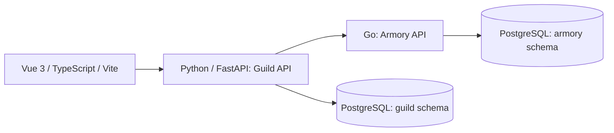

# Application specification

Draft product target, not a document to inject into every prompt condition. Agents receive only their assigned task bundle, shared envelope, prompt, and harness inputs.

## Product

An adventurers' guild manages quests, parties, reusable equipment, and expeditions. A player chooses a quest and party, requests gear, and sees whether the expedition was accepted. Later tasks add cancellation and recovery workflows.

Use original fantasy names and a small explicit ruleset. No licensed rules corpus, real-money payments, generative dungeon master, combat engine, maps, or external account services in the initial benchmark. Character levels are integers; quest eligibility is our rule, not an assumed D&D rule.

## Architecture

One PostgreSQL instance initially, with separate service roles/schemas. Python owns characters, parties, quests, and expeditions. Go owns inventory and reservations. Neither service reads the other's tables. The browser calls the Guild API. Fixed service URLs, health checks, dependency locks, database seed tooling, and launch commands are part of the common starter.

The evaluator may inspect read-only snapshots of both schemas to verify side effects. Application services must still respect ownership. Separate database transactions do not make a cross-service transaction; failure recovery must be designed explicitly in later tasks.

## Entities and rules

| Entity | Minimum data and meaning |
|---|---|
| Character | ID, display name, integer level |
| Party | ID, name, character memberships |
| Quest | ID, title, description, difficulty label, minimum/maximum party size, minimum character level, reward gold, open/closed status |
| Inventory item | ID, name, total quantity; reusable whole units |
| Expedition | ID, party ID, quest ID, state, request identity, requested items, optional reservation ID |
| Reservation | ID, expedition ID, item/quantity lines, active/released state |

Initial reservations cover the lifetime of an expedition. Time-window booking, expiration, consumables, and partial equipment returns are future tasks. This avoids mixing two different inventory models.

Domain invariants for the complete product:

* Each party has at most one pending, accepted, or cancelling expedition.
* Every party member meets the quest's minimum level; size falls within inclusive bounds.
* Only open quests can be accepted.
* Active reserved quantities never exceed item stock; quantities are positive integers.
* One batch reservation either reserves all requested items or none.
* Replaying an operation with the same idempotency key and normalized payload returns the same operation identity. A changed payload with the same key conflicts.
* A cancelled expedition eventually has no active reservation. Released equipment is reusable; repeated release does not create extra stock.

These invariants apply only where a task's canonical requirements assign them. The full product document must not retroactively enlarge an earlier task's acceptance suite.

## Task ladder

| ID | Starter | Agent assignment | Independent evidence |
|---|---|---|---|
| T01 | Pinned minimal runnable skeleton | Quest list/detail UI and Python endpoints | Filtering, boundary validation, stable ordering, loading/error/empty states, keyboard use |
| T02 | Canonical working browse/party UI, Python data layer, correct fixed Go armory | Accept-expedition API and UI | Eligibility, reservation calls, persistence, idempotency, errors |
| T03 | Canonical implementation containing a known Go concurrency defect | Repair overselling/idempotency without regressions | Deterministic synchronized requests, stock invariants, old behavior |
| T04 | Canonical working acceptance flow | Cancellation across Python/Go/UI | Repeat-safe release, state transitions, failure recovery |
| T05 | Canonical working synchronous services | Ambiguous timeout and restart reconciliation | Reservation committed before lost response; eventual consistent terminal state |
| T06 | Canonical working API/UI | Add bounded GraphQL facade | Equivalent behavior, authorization if introduced, query cost/N+1 checks |

Every task starts from its own canonical snapshot. T03 does not consume whichever T02 output happened to be produced by a condition. Existing-code tasks prohibit changes to unrelated starter components through an explicit write allowlist. A full greenfield application is a later task stratum, not the default cost of every repetition.

## T02 canonical acceptance target

T02 is the worked prompt example. It intentionally isolates ordinary acceptance behavior. Its Go dependency is fixed and verified, and infrastructure fixtures return definitive outcomes. Ambiguous committed-but-timed-out reservations and process restarts belong to T05.

| ID | Requirement | Critical for full-target acceptance? |
|---|---|---|
| R01 | Create a persisted accepted expedition for a valid party, quest, and available equipment | Yes |
| R02 | Accept via the provided UI and display the outcome using the API | Yes |
| R03 | Enforce inclusive quest party-size limits | Yes |
| R04 | Require every member to meet minimum character level | Yes |
| R05 | Reject unknown party, quest, or inventory IDs | Yes |
| R06 | Reject closed quests | Yes |
| R07 | Reject a party already assigned to a pending/accepted expedition | Yes |
| R08 | Reject zero, negative, non-integer, repeated-item, or empty equipment requests | Yes |
| R09 | Obtain one atomic reservation through the Go API and persist its ID | Yes |
| R10 | On definitive insufficient stock, create no accepted expedition and leave no active reservation | Yes |
| R11 | Same key and normalized body replay the same expedition/reservation without another allocation | Yes |
| R12 | Same key with a different normalized body returns a conflict | Yes |
| R13 | Apply explicit finite downstream timeouts; translate definitive Go unavailability to a retryable API error | Yes |
| R14 | Display in-flight state, prevent duplicate UI submissions, and preserve form values on failure | Yes |
| R15 | Expose useful accessible success/error feedback using the starter's established controls | No; separately reviewed |
| R16 | Preserve quest browsing and party selection behavior | Yes |
| R17 | Follow the task's common API, launch, stack, and file-boundary contract | Yes |
| R18 | Return the defined domain-error status/body mappings | Yes |

The private evaluator maps several fixtures to each requirement. Requirement success means all valid fixtures for that requirement pass. Do not treat every assertion as an independent sample.

## T02 deterministic behavior details

Inventory item IDs may appear once per request. Normalize the body by sorting item lines by item ID, keeping IDs and integer quantities unchanged, and serializing a fixed field order. Character names and item display names are not part of request identity.

The idempotency scope is the `accept expedition` operation in a single synthetic guild. Use one unique key per operation; no multi-tenant authentication in this task. Persist keys across application restarts for successful operations. Concurrent same-key calls must converge to one accepted operation; T03 is where Go's implementation of this behavior is directly repaired.

For this task, validation/conflict/stock errors are definitive no-allocation outcomes. The unavailable-dependency fixture rejects before any Go write. Do not claim this proves recovery from an uncertain network outcome.

Example product scenario: the three-character Lantern Company meets a quest's size range of 2–4 and minimum level of 3. It requests one rope and two lanterns. If stock is sufficient, acceptance produces one expedition and one matching reservation. A two-member party containing a level-2 character fails eligibility regardless of the average party level.

## Test construction

Provide a reference implementation, visible happy-path smoke tests, and independently authored private fixtures. Test exact bounds, each invalid input class, side effects, reload persistence, two-key same-party requests, and repeated requests with reordered item lines. For concurrency, use barriers and invariant checks rather than relying on arbitrary sleeps.

The baseline reference must pass all assigned requirements. Deliberately faulty variants must demonstrate sensitivity: average-level eligibility, check-then-write stock allocation, duplicate-key allocation, incorrect conflict response, and UI double submission.

Pin a visual viewport and use interaction/accessibility checks for primary UI grading. Pixel resemblance and subjective fantasy aesthetics are supplemental review dimensions, not functional acceptance gates.
