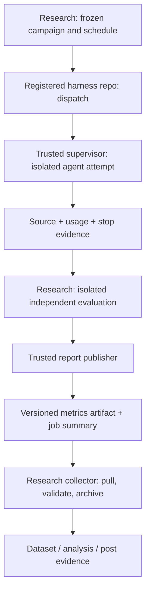

# GitHub Actions and research collection plan

Visual companions: [attempt sequence](07-system-diagrams.md#4-one-attempt-from-dispatch-to-dataset), [independent scoring boundary](07-system-diagrams.md#6-development-feedback-versus-independent-scoring), and [research ingestion](07-system-diagrams.md#7-metrics-provenance-and-research-ingestion).

This is an implementation plan, not a deployed workflow. No workflows or model credentials have been created. The generation runner, evaluator, schemas, and collector must first work locally with a fake provider.

## Architecture



Use Actions to orchestrate and report. The process doing generation may run on a purpose-built disposable worker rather than inside a repository-privileged CI job. Do not assume a Docker container sharing the host filesystem/socket is a sufficient boundary for hidden evaluation or secrets.

## Workflow responsibilities

| Workflow | Location | Trigger | Responsibility |
|---|---|---|---|
| `validate-design` | Research | Pull request | Schema/example validation, prompt/disclosure checks, manifest resolution, fake-provider tests |
| `campaign-dispatch` | Research | Manual after budget approval | Validate frozen schedule; allocate slots and dispatch registered harness entrypoints |
| `benchmark-attempt` | Harness repo | Manual workflow dispatch | Call the pinned common supervisor workflow with campaign/slot/harness refs |
| `benchmark-common` | Research | Reusable workflow call | Resolve inputs, run isolated generation, collect generation evidence |
| `evaluate-and-report` | Research/control plane | Trusted pull of generation completion | Evaluate final artifact independently; assemble authoritative result |
| `collect-results` | Research | Manual initially; later scheduled | Discover records, verify provenance, archive, normalize, update collection summary |
| `analyze-campaign` | Research | Manual frozen dataset | Produce reproducible tables, figures, and claim references |

An experiment dispatch creates generation work only. Evaluation/reporting consumes the exact finished subject hash, never a moving branch. Where a private reusable workflow is shared with harness repositories, configure GitHub's repository access and pass only explicitly named credentials. Reusing a workflow does not automatically grant the caller access to every private benchmark asset. [Reusable workflow documentation](https://docs.github.com/en/actions/how-tos/reuse-automations/reuse-workflows).

## Cross-repository collection

Start with **pull collection**. The research repo maintains a registry of repository IDs, workflow IDs/revisions, harness revisions, and expected campaign slots. A manually triggered or scheduled collector lists matching runs/artifacts through the GitHub API, downloads them with a read-scoped installation token, validates them, and writes the research archive.

Do not assume a research repo's `workflow_run` event subscribes to workflows in other repositories. Cross-repository completion needs API polling or an explicitly authenticated dispatch. A later webhook/dispatch can be a wake-up hint, but the collector still independently verifies and pulls the artifact.

Use a scoped GitHub App installation for cross-repository actions/artifact reads and authorized dispatches. Do not assume the default `GITHUB_TOKEN` can read other private repos. Separate read/dispatch/publish capabilities by job. Resolve exact permissions in the implementation and test with the intended owner/organization.

GitHub's artifact API provides enumeration and download endpoints; credentials and retention still govern access. [Actions artifact API](https://docs.github.com/en/rest/actions/artifacts).

## Attempt lifecycle

1. Validate the campaign and unused slot. Refuse unresolved models, hashes, budgets, or unknown harnesses. Mark the slot started in the trusted ledger.
2. Resolve task archive, prompt, harness, common workflow, runtime, and environment by immutable identifiers. Verify digests before launch.
3. Start the disposable generation worker. Install only selected condition assets and fresh state. Capture usage/events outside the agent's write boundary.
4. Stop on completion, needs-human, limit, cancellation, or error. Preserve partial code and stop evidence. Make durable checkpoints so forced runner cancellation does not erase the only usage record.
5. Transfer the subject archive and trusted telemetry; verify their digests. Never upload the whole worker home or environment files.
6. Launch the subject in an isolated application environment. Run private tests from an external trusted evaluator process. It can call APIs/browser and bounded read-only data probes, but the application cannot inspect evaluator source.
7. Assemble the record from campaign + supervisor + evaluator evidence. Validate schema and semantic constraints. Publish the bundle and a concise summary.
8. Collector independently validates and archives the bundle. A missing upload becomes a visible missing-slot condition and recovery task.

Use failure/cancellation finalizers where supported, but do not promise an `always()` step survives a killed runner or repository outage. Out-of-worker checkpoints and the expected-slot ledger handle that case. Reruns have distinct attempt IDs and retain lineage.

## What the GitHub summary shows

One row per attempt, plus a link to the authoritative artifact:

```text
Campaign / slot / attempt
Task / prompt / harness / profile / model
Generation stop reason
Evaluation status
Communicated acceptance: passed critical / applicable critical
Full-target acceptance: passed critical / total critical
Generation reported or estimated USD, with basis and completeness
Generation elapsed / approval wait / evaluation elapsed
Subject hash / evaluator revision / artifact reference
```

Pipeline conclusion and research outcome are separate. A well-recorded coding failure is valid data; the reporting workflow can succeed with acceptance=false. Missing usage, evaluator errors, or corrupt artifacts are visibly incomplete. Ordinary application CI may still mark failed tests red, but it is not the research dataset.

## Trust and credential boundaries

* Pin actions and reusable workflows to reviewed full commits before execution. Use minimal job permissions and ephemeral runners.
* Agents and generated applications do not receive repository-write tokens, collector credentials, or evaluator credentials. A provider gateway can meter generation without putting a reusable provider key in an agent-readable file.
* Publishing runs in a clean trusted job that does not run scripts from the generated archive. Collector ingestion never checks out and executes generated code.
* Private tests are never installed on the generation worker. Generated applications have no host socket or path mount leading to test source.
* Reporting validates provenance and JSON, not just an agent's `metrics.json`. Quarantine duplicate identities with changed bytes.
* Begin with manual dispatch on trusted frozen refs. Ordinary PRs can run zero-model validation. Do not run model generation or privileged workflows on arbitrary pull-request code.

These controls protect experimental validity as well as credentials. GitHub documents the risks of untrusted code, token scope, script injection, and pinned dependencies in its [secure-use reference](https://docs.github.com/en/actions/reference/security/secure-use).

## Retention and durability

Set explicit artifact retention within repository limits; verify collector access immediately after upload. Archive normalized records, source snapshots, reports, and evidence manifests in research-owned durable storage. Record artifact expiration and archive verification. Public posts should link to a stable released dataset, not temporary Actions download URLs.

## Acceptance criteria for the future workflow implementation

* A fake-provider campaign exercises all four harness IDs without any paid calls.
* One successful and one failing application yield valid, distinguishable research records.
* Budget/timeout/needs-human stops preserve partial evidence.
* Two collector executions produce one normalized record per attempt.
* A missing artifact is detected by comparing against the schedule.
* Agent-written fake usage and changed evaluator/subject hashes are rejected.
* Private evaluator files and credentials are demonstrably inaccessible to the generation worker and subject application.
* Scheduled collection can archive before configured expiration, and restore is verified.
