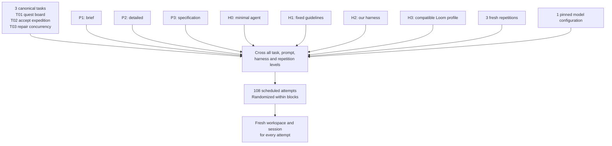
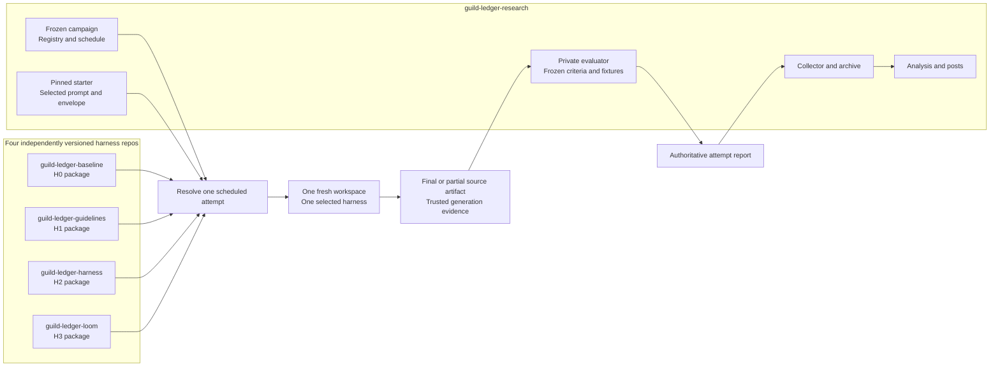
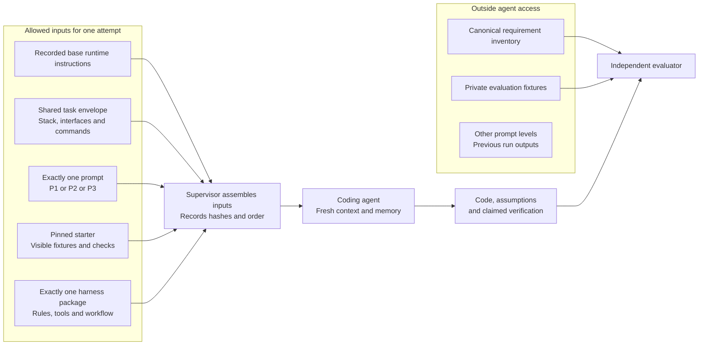
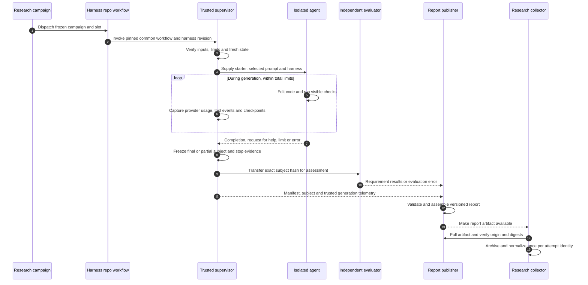
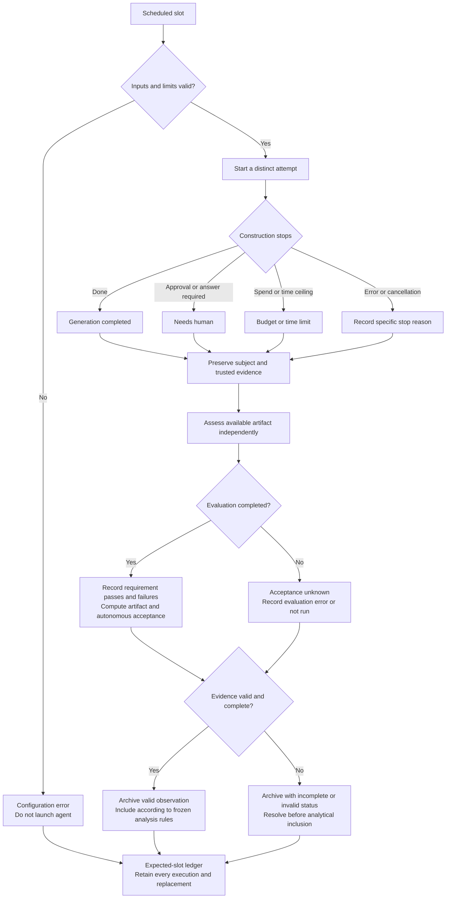
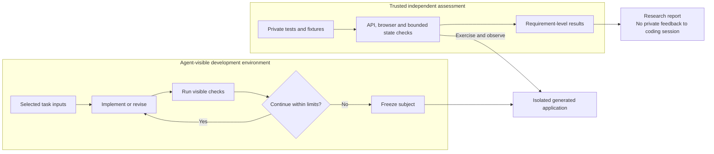
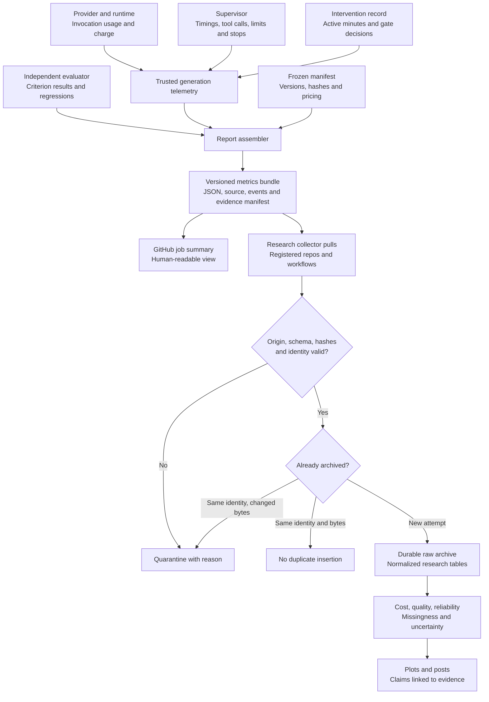

# How the experiment works

These diagrams describe the proposed system. They do not represent deployed infrastructure or completed experiments. See the linked specifications for the exact contracts and unresolved decisions.

## 1. Experiment matrix

Every prompt level is tested against every admitted harness for each task and repetition. The controlled track fixes the model configuration. Loom joins that track only if its selected profile supports the same conditions; its full native pipeline is a separately labeled comparison.

The count is a feasibility-pilot proposal, not an authorized spending plan. More models, profiles, or harnesses enlarge the schedule explicitly. See [prompt protocol](03-prompt-protocol.md).

## 2. Repository ownership and shared inputs

The harness repositories own their treatment packages. The research repository owns common task inputs and independent scoring. A harness repository never supplies its own acceptance verdict.

Only the selected harness enters a given attempt. The four incoming package arrows represent alternatives. Previous generated code is never fed into the next repetition. See [repository architecture](02-repositories-and-isolation.md).

## 3. Prompt assembly and information boundaries

The supervisor selects inputs; the agent does not receive this whole research pack. In particular, P1 cannot discover P3 or the private target through repository access.

The private nodes have no input path into the agent. Harness-generated plans/specifications can use only the allowed inputs, and their generation counts toward cost. See the [worked T02 prompts](prompts/T02/00-shared-envelope.md).

## 4. One attempt from dispatch to dataset

Actions coordinates work, but the supervisor captures generation usage. Evaluation runs after construction stops and does not return private failures for repair.

A killed worker may never return normally. Durable supervisor checkpoints and the expected-slot ledger let collection identify missing evidence instead of silently losing the attempt. See [Actions plan](05-github-actions-plan.md).

## 5. Run lifecycle and unsuccessful outcomes

Construction status, evaluation status, and research validity are separate. An agent finishing does not imply acceptance; an acceptance failure is still useful data.

Autonomous success requires completed generation, passing assigned criteria, and valid evidence. A stopped attempt can have a passing partial artifact and still fail the autonomous endpoint. Infrastructure replacements receive new attempt IDs and preserve lineage. See [metrics contract](04-metrics-and-reporting.md).

## 6. Development feedback versus independent scoring

Agent-visible tests help construction. The private evaluator measures behavior against frozen expectations. Those feedback loops have different roles.

For H2, review/repair rounds are bounded. H0 and H1 may still choose to run visible checks through their base runtime; all controlled conditions have the same declared verification tools. Source secrecy requires process/filesystem boundaries, not merely a private repository.

## 7. Metrics provenance and research ingestion

Every headline number traces to evidence from the system that actually observed it. The agent's summary is not authoritative usage or acceptance data.

Missing usage stays unknown. Failed attempts retain their costs. Unknown evaluations stay distinct from known coding failures. Archive evidence before Actions artifact expiration. See the [summary schema](contracts/run-record.schema.json).

## 8. Extending the benchmark with another harness

Adding a framework changes the treatment registry and campaign, while preserving the shared task and evaluator contracts.

```mermaid
flowchart LR
    Source["GitHub framework<br/>Pinned revision and license"] --> Adapter["Implement common adapter<br/>Declare tools, models, gates and memory"]
    Adapter --> Admit["Admission checks<br/>Isolation, usage coverage and stop limits"]
    Admit --> DryRun["Fake-provider dry run<br/>Success and failure paths"]
    DryRun --> Registry["Register versioned harness profile"]
    Registry --> Campaign["Freeze a new campaign<br/>Same task/evaluator versions for comparison"]
    Campaign --> Compare["Run new harness plus<br/>contemporaneous baseline cells"]
    Compare --> Collect["Collect through the same metrics contract"]
    Collect --> Analyze["Compare within compatible<br/>model, prompt and profile groups"]
```

Native multi-model workflows remain separate from controlled same-model comparisons. New results do not silently replace older records or inherit an old model configuration by name alone.
