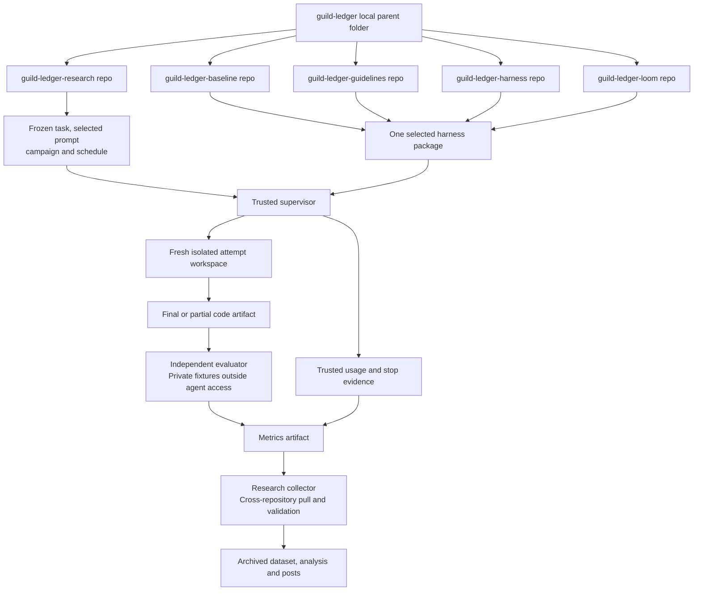

# Local workspace and separate repositories

20 October 2026. The user clarified that `/Users/oscarrieken/Projects/Rieken/guild-ledger` is the parent folder where all experiment repositories will live. The preceding monorepo interpretation was incorrect. The original separate-repository architecture remains current.

## Repository roles

| Child repository | Responsibility |
|---|---|
| `guild-ledger-research` | Canonical task inputs, prompt variants, independent evaluator, metrics contracts, collector, analysis and posts |
| `guild-ledger-baseline` | H0 runtime configuration and adapter |
| `guild-ledger-guidelines` | H1 fixed guidelines and adapter |
| `guild-ledger-harness` | H2 custom workflow and adapter |
| `guild-ledger-loom` | H3 pinned Loom profile and adapter |

Each child is an independent Git repository. The parent is a convenient local workspace, not a Git repository. All five supplied GitHub repositories are now cloned locally. New harnesses can add sibling repositories through the same registration and adapter process.

## Flow

The parent-to-repository arrows show folder containment. Harness-to-selected-package arrows show alternatives; only one selected package enters an attempt.

## Isolation

Local sibling folders are not a security boundary. Experimental agents must not receive filesystem access to the entire parent folder. Materialize only the pinned task starter, selected prompt/envelope, and assigned harness into a fresh workspace. Keep private evaluation, other prompt levels, prior outputs, repository credentials, and inherited global rules outside its access.

Harness repositories retain the original thin-package design. They share frozen task/evaluator versions rather than independently maintaining divergent benchmark applications. Generated source is an attempt artifact and must never silently become the next repetition's starter.

## Documentation and next steps

The repository architecture, cross-repository Actions plan, system diagrams, and 26-gap review remain applicable. Planning documents have been copied into this research repository’s `docs/`. The parent folder retains the earlier copy as a migration backup; maintain this checkout’s documentation going forward. No commits, pushes, application implementation, cloud workflows, or paid calls were performed during setup.
