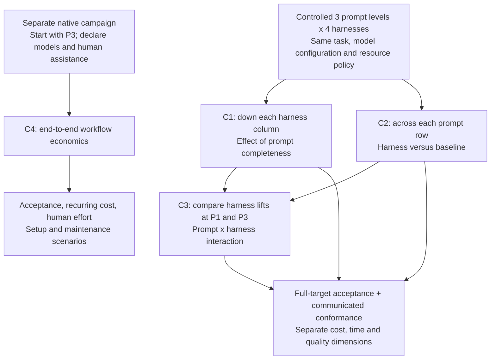

# Comparison protocol

Working definitions · 20 October 2026 · Draft for review, not a preregistered campaign. No paid runs are authorized by this document.

This defines the questions and treatment boundaries. It updates the endpoint priority in the earlier prompt/metrics drafts: **full-target functional acceptance is the common product outcome; communicated conformance is the paired implementation diagnostic**. It does not settle the T02 contract, choose a runtime/model, implement harness profiles, or resolve statistical power.

## 1. What we want to learn

1. How much does supplying a more complete product request change what gets built?
2. What does adding guidelines or a harness buy at a fixed level of product information?
3. Does a harness help more with incomplete prompts or with complete specifications?
4. Separately, what is the cost and quality of each system operating in its native workflow?

The first three questions share one controlled factorial experiment. The fourth is a separately labeled system comparison. We are evaluating bounded task outcomes in Guild Ledger, not claiming a universal ranking of agents or whole software products.

## 2. Controlled factors

| Factor | Levels | Definition |
|---|---|---|
| Prompt | P1 brief, P2 detailed, P3 specification | Increasing disclosed product requirements; nested requirement inventories |
| Harness | H0 baseline, H1 guidelines, H2 custom, H3 compatible Loom | Added instruction/context/workflow bundle on the same base runtime and model configuration |
| Task | T01, T02, T03 initially | Independent pinned starter and evaluator per task |
| Repetition | Three per cell in the feasibility pilot | New workspace, session, and attempt identity each time |
| Model | One selected configuration per controlled campaign | Fixed provider/model identifier, reasoning settings and supported parameters |

A task's canonical target and evaluator do not change with prompt level or harness. Product requirements disclosed through the starter count as available information, not prompt omissions. Final exposure maps must account for every input channel.

### The twelve cells

| Prompt | H0 baseline | H1 guidelines | H2 custom | H3 compatible Loom |
|---|---|---|---|---|
| P1 brief | P1/H0 | P1/H1 | P1/H2 | P1/H3 |
| P2 detailed | P2/H0 | P2/H1 | P2/H2 | P2/H3 |
| P3 specification | P3/H0 | P3/H1 | P3/H2 | P3/H3 |

Compare down a column for prompt effects; across a row for harness effects. Compare those differences for interaction. Do not count the matrix multiple times: three tasks and three repetitions give 108 attempts for these same twelve cells with one model. If H3 is incompatible, the four-column controlled matrix is not executable as specified; redesign the campaign and count openly.

## 3. Outcomes and denominators

For each task, freeze a complete canonical requirement set and the critical subset before any comparative runs. Assign criticality independently of the treatment results.

| Outcome | Meaning | Use |
|---|---|---|
| Full-target artifact acceptance | All critical canonical requirements pass independent evaluation | Common product-fit outcome across all twelve cells |
| Communicated artifact conformance | All critical requirements explicitly available through that condition's inputs pass | Distinguish implementation misses from omitted information |
| Autonomous full-target success | Generation completes within limits and artifact meets full target with valid provenance | Primary operational endpoint for the autonomous controlled campaign |
| Autonomous communicated success | Generation completes within limits and artifact conforms to communicated critical requirements | Diagnostic of autonomous execution against supplied expectations |
| Requirement-level results | Each assigned criterion's result; unknown where unmeasured | Explain failures and partial progress |
| Maintainability, UI/accessibility, robustness | Separate prespecified review/test dimensions | Secondary quality evidence; no combined weighted score |

A full-target failure under P1 is a product mismatch, not automatically evidence of poor coding: the omitted rule may never have been supplied. Communicated denominators differ, so do not use those rates as a like-for-like cross-prompt quality ranking.

An observed needs-human, budget/time stop, cancellation, or agent error establishes autonomous non-completion, even if artifact evaluation is unavailable. Preserve its partial artifact score if measured. For completed generation with unavailable evaluation, artifact acceptance and autonomous success remain unknown. Infrastructure classifications and replacements follow the separately frozen adjudication rule; they are not silently coding failures or deleted observations.

For all comparisons, show generation cost, recurring verification cost, wall time, active human minutes, setup/maintenance allocation, usage completeness, stop reasons, and missingness separately. Count failed/charged calls and all child/reviewer calls. Unknown usage is not zero.

## 4. C1 — Prompt completeness

**Question:** Holding the harness fixed, what changes when the request becomes more complete?

**Contrasts:** P2 versus P1, P3 versus P2, and the endpoint difference P3 versus P1, within each harness/task/model stratum. P3-versus-P1 is derived from the same cells, not another set of attempts.

**Hold constant:** Harness revision/profile, model/runtime configuration, starter, evaluator, available underlying task data and visible verification, environment, and campaign resource policy. Only the designated prompt body changes; all levels share the same mechanical envelope.

**Main reading:** Difference in autonomous full-target success, backed by artifact-only results, requirement-level product fit, and cost/time. Report communicated conformance to explain whether remaining failures concern instructions actually supplied.

**Claim supported:** The effect of this requirement-completeness package for the tested tasks and systems. It cannot isolate prompt length, typography, examples, or specification formatting: those are separate ablations. No claim that a model should infer an arbitrary hidden business rule.

## 5. C2 — Added harness bundle

**Question:** At the same prompt level, does an added harness produce a better or more economical outcome?

**Primary comparator:** H0. Compare H1−H0, H2−H0, and H3−H0 within P1, P2, and P3. Direct H2-versus-H1 and H3-versus-H2 comparisons are secondary/descriptive unless separately designated in the final analysis plan.

**Hold constant:** Exact prompt and starter hashes, full target, model/runtime configuration, base tool access, visible verification information, external/network policy, environment, and total resource policy.

**What may differ:** Added generic instructions, context organization, planning/review/repair orchestration, and declared framework wrappers over the same available task information. Model calls made to plan, summarize, review, or create tests count inside the attempt. Framework-specific tools are declared treatment components; do not quietly give one condition additional product contracts or hidden tests.

**Main reading:** Autonomous full-target success with cost/time tradeoffs. Communicated conformance tests whether the harness better executes supplied requirements. Maintainability and UI/accessibility evidence stay separate.

**Claim supported:** The effect of the configured harness bundle, not a claim that any one component caused it. H2's extra review calls are part of its treatment and cost, not free assistance.

## 6. C3 — Prompt × harness interaction

**Question:** Does the benefit of a harness change when the prompt becomes more complete?

For each H1/H2/H3, compare its lift over H0 at P1 with its lift over H0 at P3. Use P2 to examine intermediate behavior.

```text
lift(H, P) = success_rate(H, P) - success_rate(H0, P)
interaction(H) = lift(H, P3) - lift(H, P1)
```

Use percentage-point differences for this success endpoint. Negative interaction means a larger harness lift at P1; positive means a larger lift at P3. Neither direction is assumed to be better. Calculate within task/model strata before the predeclared task aggregation, and include uncertainty.

**Main reading:** Full-target interaction with requirement-level and communicated-conformance diagnostics. If a framework only sees P1, a product-fit improvement does not prove it recovered missing requirements reliably; inspect whether generic defaults happened to match our target.

**Claim supported:** Whether prompt completeness moderates the effect of the tested harness bundle. A single aggregate harness leaderboard would hide this relationship.

## 7. C4 — Native workflow economics, separate campaign

**Question:** What does it cost to obtain an acceptable task result using each system as intended?

Start this extension with P3 only to reduce ambiguity about expected behavior. Give systems the same starting target information and independent scoring. Allow declared native model routing, multiple agents, context mechanisms, review cadence, and genuine approval gates. Keep operator authority and assistance limits explicit.

Separate autonomous native runs from assisted native runs. Do not disable Loom's gates or supply unrecorded human assistance. Assisted records include permitted decisions/edits, active human minutes, waiting time, and repair limits. If a native system requires extra task information, disclose it, account for its preparation, and do not label that result information-controlled.

**Main reading:** Full-target acceptance and quality dimensions versus total recurring cost, time, and human effort; show setup/maintenance scenarios with stated reuse. Report native model mixtures and stage costs.

**Claim supported:** Economics of a configured system and workflow, not an isolated same-model harness effect. C4 does not share the 108-attempt pilot allocation. Its sample size and resources require their own campaign plan and authorization.

## 8. Treatment separation requirements

### H0: baseline

Use the recorded base coding-agent runtime with shell/editor access and declared visible task checks. No added project-wide planning, review, testing process, memory, skills, or harness instructions. This is “no added harness,” not “no system prompt.” Existing runtime behavior remains and is documented.

The shared envelope specifies stack, data/transport interfaces, editable scope, environment, invocation, and common operating limits. It must not tell H0 to follow H1's process. Trusted instrumentation gathers usage and code diffs; baseline reporting requirements should be minimal and identical across conditions.

### H1: guidelines

Same runtime, information, and base tools as H0, plus one fixed generic process instruction file. It adds no product requirements, examples, special tests, or extra human feedback. Freeze its exact text and injection position.

### H2: custom harness

Same product information/model configuration as H0, plus a frozen planning, visible-check, review, and repair workflow. At most two review/repair rounds in the current proposal. Define separate reviewer context and orchestration precisely. Generic validation over already-available source is permitted; hidden-target retrieval is not.

### H3: Loom

Register the exact upstream revision, installed bundles, effective instructions, tool behavior, retrieval corpus, model choices, gates, and usage mapping. Admit a controlled profile only if it actually supports these controls. If it does not, report incompatibility and use the native track; do not rename a reduced custom workflow “full Loom.”

### Prompt text

Remove incidental process demands from prompt bodies when those demands duplicate the harness treatment. P3 can still supply richer product semantics and acceptance examples; those are part of the completeness package. Reaudit all inputs after editing. The existing T02 prompt files remain draft and must be revised with its contract; this document does not pretend that cleanup is done.

## 9. Resource policy

Primary controlled operating condition: one shared total generation USD ceiling per attempt within a campaign/model, plus a common wall-clock safety ceiling and documented tool/token guardrails where supported. The final manifest must name actual values and record which limit stopped the run. All framework invocations count; no extra budget is awarded after an external failure.

This tests outcomes under a stated budget. It is not an equal-token or equal-number-of-model-calls experiment. If several limits often bind, analyze stop reasons and do not attribute every failure to code reasoning. Native systems use their own declared operating policy and are labeled separately.

Per-attempt spend, tool/runtime limits, and acceptable in-flight overshoot remain unresolved. No calls are authorized until they are set. Budget-response curves and model-tier crossovers are follow-up studies, not extra hidden pilot retries.

## 10. Analysis priority and claim discipline

The feasibility pilot is descriptive and operational; it will not announce statistically established harness winners.

For a later confirmatory campaign, the proposed headline contrast family is:

1. P3 versus P1 under H0: prompt-completeness effect on the base system.
2. H1 versus H0 under P3: added guidelines when the task is fully specified.
3. H2 versus H0 under P3: custom harness bundle under complete information.
4. H3 versus H0 under P3, if a compatible controlled H3 is admitted.

All use autonomous full-target success. Report the whole matrix, the P1/P2 harness contrasts, C3 interactions, continuous/requirement quality, and cost/time distributions as prespecified secondary results. If H3 is excluded, freeze the changed contrast family before execution. Future multiple-model campaigns have an explicitly expanded analysis plan.

Do not reinterpret this priority as approval to ignore failures or cost. A harness can be more reliable and more expensive; both observations must appear. Cost per successful result includes generation spend on unsuccessful eligible attempts, requires complete cost coverage and at least one success, and is an observed ratio rather than a promise about future retries.

The final analysis plan must set uncertainty methods, task weights, treatment of task clustering, multiplicity, minimum meaningful effect, sample size, exclusions, replacement rules, and missingness bounds before confirmatory execution. This document fixes the questions and comparison hierarchy, not those remaining statistical choices. The same task/repetition/time block improves balance but does not make model outputs deterministic.

## 11. What stays outside the first campaign

- Equal-information prose versus structured specification: isolates format rather than completeness.
- Example/no-example ablation: isolates examples.
- Guidance/retrieval/review/sensor ablations: isolates bundle components.
- Human clarification and repair after private evaluation: changes information and intervention.
- Warm memory and cross-run learning: changes state policy.
- Model selection/cost tiers and long-term setup reuse: separate system/economics questions.
- Whole-application greenfield builds and unrelated product domains: broader task strata.

These are useful extensions, not conditions to quietly mix into the twelve controlled cells.

## 12. Comparison map



## Remaining freeze dependencies

T02 semantics and all task criteria; input exposure maps and prompt edits; runtime/model selection; supported H2/H3 profiles; concrete limits; evaluator sensitivity; trusted metering and semantic validation; retry/missingness rules; and the final statistical plan. The existing draft run-summary schema needs alignment for known autonomous non-completion with unmeasured artifact quality; its current null rule is not the final outcome contract. The audit remains open. No document here constitutes measured evidence or an approval to commit, push, or spend.
