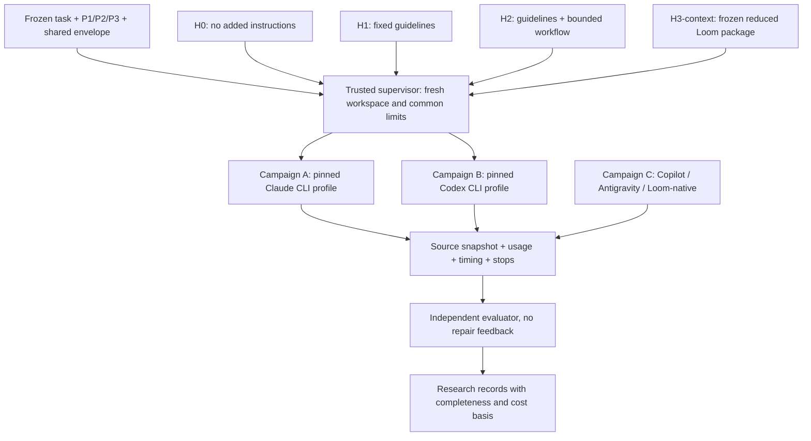

# Harness alignment and implementation plan

Updated 21 October 2026. Proposed profiles following [all runtime reports and selection](12-runtime-options.md). No paid runs or global configuration changes authorized. Runtime selection is provisional pending admission.

## Compare within a runtime first

Runtime is the existing coding engine, native tools and platform behavior. Harness is our added treatment. H0 means no added experimental harness. Each campaign uses the same runtime binary, model/effort, auth, base tool catalog, task inputs, runner image and aggregate limits across its supported harnesses. H1–H3 may spend their shared allowance differently; extra stages and review overhead count against that same allowance.

Keep the five sibling repositories. They version packages, not five divergent application implementations. A supervisor assembles a task snapshot with exactly one package in a fresh disposable workspace. Do not point agents at the parent `guild-ledger/` directory, research checkout, other harness packages, or evaluator source.

Arrows to a runtime express intended profile support, not admission. Codex does not currently have a demonstrated Loom-native provider.

## Treatment packages

| ID / repository | Proposed package | Execution | Explicit boundary |
|---|---|---|---|
| H0 / baseline | Empty added-instruction package with a manifest | One fresh coding session under native behavior | Shared task mechanics only; no plan/review/checklist instruction added by us |
| H1 / guidelines | One short frozen generic guidelines document | Same session mechanics as H0 | No new domain facts, tools, worked acceptance solutions or external corpus |
| H2 / harness | Exact H1 bytes plus explicit planning, implementation, visible verification, one independent review and at most one repair pass | Supervisor enforces stage transitions; reviewer gets task, diff and visible results, not private tests | Fixed same model/effort; review/repair calls count in aggregate limits; no recursive reviewers |
| H3-context / loom | Frozen selection of upstream Loom instructions/reference assets | Same base session mechanics as H0/H1 | Reduced context treatment, not native Loom; exclude extra product facts, model routing, privileged tools and unmetered review |
| H3-native / loom | Pinned real Loom pipeline, agents, retrieval corpus, model policy, tools and human gates | Separate campaign C | Preserve native workflow; meter all stages; human gates stay visible, never silently bypassed |

H2's stage count is a proposed treatment definition, not an already implemented orchestrator. A reviewer starts with fresh context; a repair session receives the review and working tree with all supplied context hashed. Planning/implementation/visible checks may occur in the initial coding session, with explicit checkpoints. Native spontaneous planning in H0 is allowed: we manipulate supplied process, not private reasoning. Capture concise plans and verdicts, never private reasoning text.

H1 guidelines should cover general implementation care without creating mandatory workflow stages. H2 explicitly measures a workflow added to the same H1 guidelines; H3-context is an alternative context package, not automatically H1 plus Loom. H2 versus H0 measures the combined package; H2 versus H1 more narrowly measures the added workflow. Do not claim all four treatments are an equal-token dose.

The existing [shared T02 envelope](prompts/T02/00-shared-envelope.md) includes edit scope, tools/commands, no clarification, and final reporting. Those are common mechanics. Audit its process language before freeze: keep instructions to use visible verification or produce evidence constant across all conditions, and avoid duplicating them as purported H1-only effects. Harnesses must not add missing P1/P2 product facts from the full specification.

## Compatibility and admission status

| Exact surface | H0/H1 | H2 | H3-context | H3-native |
|---|---|---|---|---|
| Claude CLI headless | Candidate; launch/auth/context contract untested | Candidate; supervisor required | Candidate; package not selected | Existing source adapter; must audit/build/mock-test, campaign C first |
| Codex CLI | Candidate; desktop discovery is not a CLI test | Candidate; separate adapter required | Candidate if identical package information can be delivered | No Codex provider in inspected selector; unsupported in current source |
| GitHub-hosted Copilot | Native baseline candidate; repository guidance exposure unverified | Customizations documented, bounded enforcement unverified | Not demonstrated | Not demonstrated |
| Antigravity IDE | Native baseline candidate with global plugins recorded | Attended workflow possible; automatic limits unverified | Not demonstrated | No adapter demonstrated |
| Claude desktop/Projects | Different host/account context; omit from controlled pilot | Native behavior only, unverified | Not demonstrated | Not demonstrated |
| Copilot local VS Code | Distinct runtime; defer | Not demonstrated | Not demonstrated | Not demonstrated |

Unknown is not unsupported. No row is certified. See the runtime comparison for each supporting report, including pre-reset history and reviewer notes.

## Loom alignment work before H3 admission

Source reinspection at HEAD `3a41006238a43bbd0920f3ef108091641b1be00e` found these concrete integration gaps:

- The selector supports Claude and mock. Do not substitute Codex without an explicit adapter and new profile.
- `newClaudeProvider()` supplies `AgentsDir`, leaving `IsolateProjectContext` false by default. A source comment about isolation is not evidence that the current launcher enables it.
- The invocation inherits the environment and does not explicitly set model or effort in the inspected command construction. Establish one shared, tested configuration route for every stage before controlled use.
- Stage definitions affect tool approval. Approval lists and actual tool availability are different; measure the effective catalog and distinguish intentional native-tool differences from controlled equality.
- `exec.CommandContext` stops the direct child; `WaitDelay` bounds pipe waiting, not the whole descendant process lifetime or server inference. The trusted supervisor needs process-tree stop handling and incomplete-usage recording.
- JSON result collection is buffered. A killed stage can lack its final result and usage; stage totals alone do not establish complete failed/child/retry accounting. Preserve available raw envelopes and capture gaps explicitly.
- The checkout has local changes. Create a separate clean pinned source export/build and record exact asset hashes; do not modify or reset the personal checkout. Use a project-local binary, not global installation.

These are design tasks, not authorization to patch upstream Loom or execute real model calls. A mock provider and fake CLI can test lifecycle and artifact contracts first. Native gates that need a person yield `needs-human` in autonomous analysis; assisted outcomes belong in the native track with intervention time recorded.

## Profile manifest contract

Each package/runtime pairing needs a versioned manifest containing:

- Identity: harness ID, profile ID (`controlled-context` or `native-pipeline` where relevant), package commit/export digest, runtime adapter revision and binary hash.
- Inputs: canonical task/starter/prompt/envelope hashes, ordered injected instructions, asset/corpus digests, discovery paths and exposure audit.
- Runtime: requested model/effort, allowed response labels/fallback policy, auth mode, runner/image digest, locale/clock policy, base tools, permission and network policy, memory/plugin/MCP state.
- Workflow: stage graph, session boundaries, reviewer/repair limits, aggregate wall/spend policy, child-call policy, and human gates. Numeric budgets remain unset and block live dispatch until approved.
- Measurement: usage adapter/version, event lineage/deduplication rules, cost basis/rate-date, completeness flags, source capture, stop handling, artifact destination and evaluator reference.

Record observed execution separately from the intended manifest. Refuse silent fallbacks; quarantine mismatched model labels, inputs, package hashes or tool exposure. Use immutable references; do not use a floating branch as a campaign input.

## Common mechanics and measurements

The supervisor assembles `task + shared envelope + P-level + treatment` in a fixed documented order. Only treatment bytes and permitted stage topology change within a harness comparison. It records start/end, approval wait, all sessions/children/retries, stop reasons, and final source outside the agent's write boundary. All stages see the assigned P-level, never an upgraded spec. Same visible tests and build tools are available to all; only H2 adds a required verification/review sequence.

Use one aggregate allowance per attempt, not a fresh full budget per stage. Predeclare cache policy: fresh local state does not flush provider caches. Record cache categories, block/randomize schedule, and retain actual cache behavior rather than claiming uncached execution. No provider fallback or cross-run session resume in the controlled pilot. A timeout, runtime error or needs-human remains in the autonomous success denominator; unavailable usage stays unknown.

Primary outcome remains autonomous full-target functional success. Also retain communicated conformance, visible test evidence, independent quality/accessibility scores, elapsed time, usage, and human intervention. Report measured token categories, list-price equivalents, runtime estimates, attributable billed USD, setup labor and CI/evaluation compute separately. Cross-runtime tokens and credits are not common cost units. Missing USD prevents a complete monetary ranking, not a quality/time analysis.

## Work order

1. Freeze the comparison definitions and resolve task/starter/evaluator contract gaps. Start with one synthetic non-benchmark task and one real task package for dry-run integration, not the full factorial.
2. Specify H1 text and the H2 stage contract; select a reviewable reduced Loom asset bundle or explicitly defer H3-context. Do not invent H3 support to complete the matrix.
3. Implement a common Python supervisor with runtime adapters; keep provider-specific event handling separate from scoring. Use the same supervisor for both CLI campaigns.
4. Implement zero-model fake-CLI tests: success, missing usage, duplicate events, child accounting, timeout, nonzero exit, needs-human, malformed artifacts and aggregate-limit exhaustion. Validate independent source capture and hidden-evaluator separation.
5. Build Loom project-locally from a frozen source export and test mock execution only. Decide whether native compatibility is worth the integration work before modifying an adapter.
6. Prepare a concrete calibration manifest with chosen auth/model, requested calls, limits and overshoot risks. Obtain separate authorization before real calls. Discovery sessions do not authorize this step.
7. Admit compatible profiles, then freeze randomized/blocked schedule, repetitions, failure/retry rules and dataset schema before benchmark budget approval. Add Codex after the Claude measurement path works; add native systems after artifact collection and human-effort logging work.

## Existing collector boundary

The [Copilot collection workflow](../runtime-discovery/github-copilot-coding-agent/collection-workflow.md) is implemented and its corrected PR report has been collected and merged. It transports agent-authored report files from an immutable PR head to an expiring artifact. It is not a benchmark runner, usage exporter, semantic validator or evaluator. The [broader Actions architecture](05-github-actions-plan.md) remains an implementation plan.

## Container implementation update — 21 October 2026

The [initial Claude containers](../../containers/claude/README.md) are built locally: real CLI 2.1.304 and a separate fake-runtime image. Offline checks cover fresh-state synthetic edits, known contamination rejection, source preservation and failure/timeout artifacts. The [verification receipt](../../containers/claude/verification.json) records image/source hashes. This implements a no-model runner foundation, not runtime admission: live mode, credentials, provider egress, effective context checks and H3 package injection remain disabled or unimplemented. H1/H2 definitions and offline initial-stage assembly are now implemented; the H2 live stage controller remains unimplemented. See [treatment definitions](16-h1-h2-treatment-definitions.md).

## H1/H2 definition update

Draft package version 0.1.0 is defined in the guidelines and harness repositories. H2 vendors identical H1 guideline bytes. The [treatment registry](../../harness-packages.json) pins manifest hashes; [detailed stage contracts](16-h1-h2-treatment-definitions.md) define handoffs, review validation, conditional repair and stop rules. Container integration verifies package exposure and prompt assembly using a fake runtime; it does not demonstrate a real H2 workflow.
