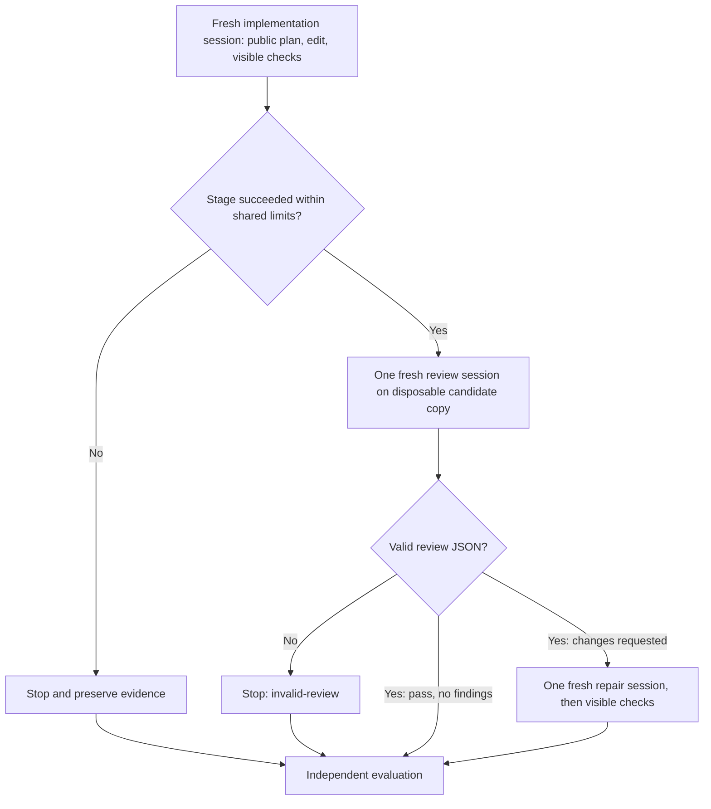

# H1 guidelines and H2 bounded workflow

Draft 0.1.0 · 21 October 2026. Defines the treatments and their first container integration. No model runs, global installation or campaign admission are authorized by these definitions. H1/H2 draft packages were committed and published on 22 October 2026; their exact source commits are recorded in the registry.

## H1: short coding guidelines

The canonical text is `package/guidelines.md` in the sibling `guild-ledger-guidelines` repository. It asks for small coherent changes, existing conventions, explicit error handling and state guarantees, prudent input/security handling, readable typed interfaces, and honest focused verification. It adds no Guild Ledger requirements, task answers, skills, tools, mandatory plan or independent reviewer.

The package has one `coding` stage so the manifest can describe injection consistently with H0 session mechanics. This stage declaration is not an extra coding session. H0 may naturally plan or test; H1 does not forbid that behavior.

## H2: H1 plus a bounded process

`guild-ledger-harness/package/guidelines.md` vendors the exact canonical H1 bytes. Its other assets are `workflow.md`, `implementation.md`, `review.md`, and `repair.md`. Every asset is listed by hash in its manifest. There are no custom skills, added tools or automatic instruction filenames.



Independent evaluation may score any captured partial candidate, but timeout, invalid-review, needs-human and runtime failure remain unsuccessful autonomous attempts. Review pass is not a benchmark pass. Evaluation errors or absent artifacts are recorded as unavailable; do not invent scores.

| Stage | Agent-visible input | Allowed output / transition |
|---|---|---|
| Implementation | Exact assigned prompt/envelope/P-level, H1 guidelines, H2 workflow and implementation instruction, canonical starter | Public concise plan, candidate source and visible check/handoff evidence; success advances once to review |
| Review | Same original prompt, H1 guidelines, H2 workflow and review instruction; fixed candidate snapshot/diff; visible commands/results and handoff | Fresh model context, separate disposable copy, no candidate edits; one validated verdict; no child reviewers |
| Repair | Same original prompt, H1 guidelines, H2 workflow and repair instruction; unchanged candidate snapshot, visible evidence, validated review | One fresh session; bounded supported repairs and visible checks; no new review loop |

The reviewer may inspect and run visible checks in its copy; changes there never replace the candidate. A future supervisor must validate the candidate hash before/after review. Review is a role/tool-permission restriction inside H2, not extra tool access. Approved base tools stay the same as H0/H1; the reviewer receives a restricted view. H2 is a combined workflow/context treatment, not a pure test of reviewer wording.

Record actual prompts and session boundaries. Do not carry implementation chat history into review; supplied source and concise handoff are explicit inputs. Repairs receive the review and candidate, not private evaluation feedback. A selected P1 prompt remains P1 at every stage. Guideline security advice does not authorize adding unstated business rules.

## Review control contract

`guild-ledger.h2-review/v1` is a JSON object containing only `schema_version`, `verdict` and `findings`. Verdict is `pass` with zero findings, or `changes_requested` with at least one finding. Each finding contains a unique `id`, `severity` (high/medium/low), workspace-relative `file`, positive `line` or null, and nonempty `issue`, `evidence`, and `requested_change` strings.

The container's shared `treatment.py` validates this structure and path syntax. That is validation of proposed control data, not of the factual truth of a finding. The future supervisor must also check referenced paths against the snapshot and task edit scope, retain unsupported findings for analysis, and treat review text as untrusted data. Malformed/missing review stops with `invalid-review`; do not buy an extra reviewer call to repair its JSON.

## Limits and stops

Maximum planned sessions: H0/H1 one coding session; H2 one implementation + one review + zero or one repair. A session may contain many provider calls; these counts are not provider-request caps. All native retries, stages, child calls if unexpectedly observed, and failed calls belong to the same attempt accounting. Recursive agents are disallowed by the profile and must be enforced by the live tool policy, not just the prompt.

One shared wall-clock and approved spend allowance applies across all stages. Check remaining allowance before each transition; never reset it for the reviewer or repair. Exact amounts, per-stage allocation and termination grace are campaign inputs still unset; they block live dispatch. Reviewer latency and full context overhead count as H2 cost. An empty budget is not zero-cost permission. Needs-human, timeout, runtime-error, invalid-review and exhausted allowance stop further stages and preserve partial evidence.

## Explicit container assembly

Run from the research checkout after building the container images. The package registry records reviewed manifest hashes; it does not resolve them from a floating branch at runtime.

```sh
python3 -B containers/claude/run.py \
  --image guild-ledger-claude-smoke:local \
  --task /absolute/path/to/task \
  --prompt /absolute/path/to/assigned-prompt.txt \
  --output /absolute/path/to/new-h1-output \
  --harness-id H1 \
  --harness ../guild-ledger-guidelines/package \
  --harness-digest 3c680bfcbe92527377016175cd08d4bc649bad968a5bd160bda798432562c8e4
```

For H2 use `--harness-id H2`, `--harness ../guild-ledger-harness/package`, and digest `f5b160533d307fcd627080d4dc5555b71d2fdc53453ea56de2b3de644d18c5a6`. Omit all harness options for H0.

The host verifies the explicit digest, asset hashes, exact file set, harness identity, stage topology and policy before Docker starts. It copies only `package/`, never the sibling repository. The staged package and prompt are mounted read-only under `/inputs`; no treatment file is added to `/workspace` or the home directory. Container preflight re-verifies hashes and deterministic prompt assembly. The output archives inputs, assembled-prompt hash and package identity. H0's prompt bytes remain unchanged.

The assembled initial prompt is `assigned prompt` followed by ordered treatment assets with stable delimiters. H1 appends only the guidelines. H2 appends the same guidelines, workflow and implementation-stage instruction. Other stage prompts can be assembled deterministically, but live adapters must supply the stage-specific candidate/handoff/review inputs and record their hashes separately.

The fake runtime consumes this assembled prompt. **No Claude inference is enabled.** The later [fake H2 controller](17-h2-fake-stage-controller.md) now executes the stage graph offline. Real CLI info still performs version/help only. Runtime effective-context confirmation, approved auth/network/tool policy, real-runtime controller integration and provider accounting remain live-run gates.

## Package evolution and verification

[harness-packages.json](../../harness-packages.json) records source repositories, local export paths, manifest hashes and shared guideline hash. Source commits now identify the published H1 and H2 package revisions. The manifest digest identifies its exact bytes and transitively the listed assets; it does not prove those bytes are sensible, so review and freeze them before a campaign.

When H1 changes, deliberately update H2's vendored bytes, manifests and registry together, then rerun tests and create a new package revision. Do not change active campaign inputs. Pin the package export/commit and image ID in each admitted profile. These packages are intentionally small enough to audit before that step.

```sh
python3 -B containers/claude/tests/smoke.py
python3 -B containers/claude/tests/treatments.py
```

The second test accepts `--h1` and `--h2` package paths for separately exported checkouts. It checks shared guideline bytes, H0 preservation, H1/H2 container exposure, tampered/missing/extra input rejection, policy enforcement and review-control semantics. Both suites use synthetic data only.
