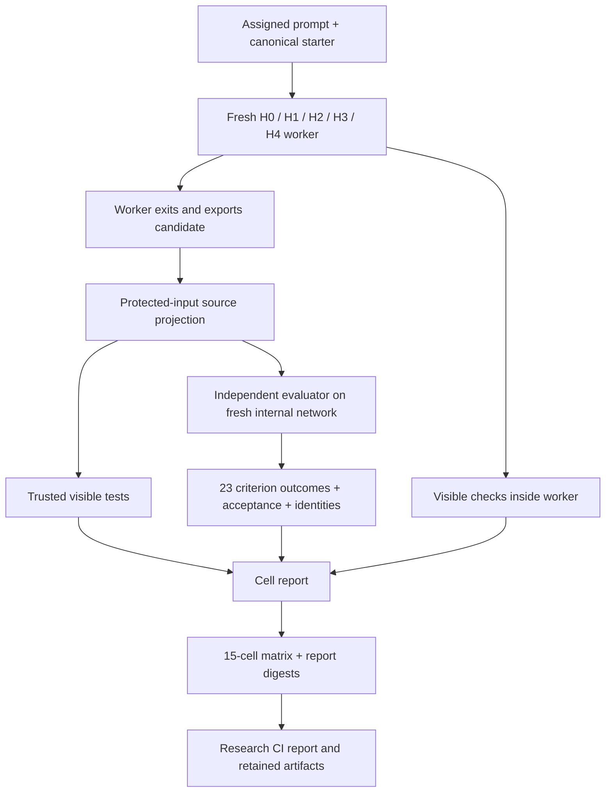

# Independent T01 acceptance in harness run reports

The trusted T01 supervisor now evaluates each exported H0–H4 candidate at every prompt level. It runs all 23 API/Chromium criteria after the worker and any native implementation/review/repair pipeline have finished. Workers receive only their existing task inputs and visible test tool; evaluator code, criteria, reference implementations and acceptance feedback are never supplied to them.



The matrix schema advances to `guild-ledger.t01-harness-smoke/v2`. Each cell embeds its `guild-ledger.t01-acceptance/v1` record and links the separately retained report by relative path and SHA-256. The matrix adds `independent_acceptance`, containing per-cell results and completed/accepted/rejected/unknown counts. The outer offline CI report exposes this as `t01_independent_acceptance` and links the complete matrix through `t01_report`. The evaluator records candidate source hashes, image IDs/platform, evaluator digest, fixture digest, browser version, criterion evidence, cleanup, and null unknown model usage/cost. Consumers can use these reports without parsing runtime logs. Cell `elapsed_seconds` is total supervisor wall time, including visible checks and independent evaluation; `acceptance.seconds` records judge orchestration separately, and neither is a provider token/cost measurement. Native runtime evidence remains separately retained.

The mock implementations intentionally leave the starter unfinished. Infrastructure verification therefore requires a completed **false** full-target result, with all criteria present and the known missing list/UI behavior rejected at A01/U01. This mock expectation remains separate from the actual product score. An evaluator failure yields unknown acceptance and fails verification. Identity mismatches, partial criteria, forged counts, paid/model activity or failed cleanup cannot become successful mock results. Full-target acceptance and communicated conformance retain their existing meanings; communicated conformance is null pending a separate audit.

The existing visible green witness and protected-input controls still run. Original harness packages, adapters, assigned prompt bytes and starter bytes are unchanged. The evaluator identity changes because it binds the supervisor source; earlier verification receipts remain historical, rather than being silently updated to claim verification of new source.

Run all combinations with:

```sh
python3 -B scripts/t01_harness_smoke.py --build --output /tmp/t01-acceptance-matrix
```

The output directory must be new. Builds may download dependencies; worker execution has no external network, and post-run services/judge use internal-only networks. No provider credentials or model execution are enabled. The offline GitHub action now also triggers on evaluator changes, builds the judge, runs acceptance-integrity tests and retains every per-cell evaluation. Publishing these changes and hosted verification are separate from local testing.

Seven additional supervisor tests cover expected rejection, evaluator errors, candidate/evaluator identity mismatches, missing/duplicate criteria, forged scores, cleanup/subset/model-call violations and unexpected mock product success. Two collector tests also confirm evidence preservation during unrelated CI failures and absence of invented results when the matrix is missing. Together with the existing projection tests and independent score-integrity tests, these check reporting failure modes rather than duplicating product assertions.

## Local verification — 2026-10-24

All 15 combinations completed with passing integration assertions and complete 23-criterion evaluations (345 observations). Each unchanged mock passed A11/A12 and failed the remaining 21 criteria, yielding the expected full-target rejection. No evaluation was unknown or incomplete. The separate full reference control passed all 23 criteria with the same evaluator identity. All acceptance cleanup checks passed; all 21 in-worker visible-test invocations were retained.

The 19 supervisor/report-collection tests, eight independent score-integrity/input-exclusion tests and two packaging tests passed. The [verification receipt](../../containers/t01/acceptance-verification.json) records identities, source hashes and artifact digests. Raw evidence is archived locally in ignored `ci-offline-results/t01-acceptance-integration-20261024/`, including the separate full-reference control. These changes and this verification are local and uncommitted; the updated GitHub action has not been dispatched for them. These synthetic observations establish reporting and integration behavior; they do not admit a runtime, demonstrate generated-code quality or authorize paid calls.
