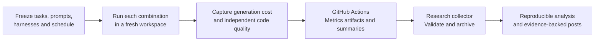

# Guild Ledger: coding-agent research plan

Current layout: [local workspace containing separate repositories](09-workspace-layout.md). The original four-harness-repo plus central research-repo plan remains current.

Draft v0.2 · 20 October 2026 · Oscar Rieken

Status: the five supplied GitHub repositories have been cloned locally, and this planning pack has been copied into the research checkout. The manual Copilot report collector has run successfully; application implementation and paid benchmark/calibration experiments have not run. JSON examples are synthetic, not research results.

Review status: [Critical review and missing parts](08-critical-review-and-gaps.md) identifies 26 gaps and a proposed resolution order. The protocol remains unfrozen; that review does not silently change its treatments or scoring rules.

## What we are building

Guild Ledger is a fantasy adventurers' guild application: browse quests, form a party, reserve equipment, accept a quest, and cancel an expedition. It is also a repeatable benchmark for prompt completeness and agent harnesses.

The application uses Vue 3 + TypeScript + Vite, Python/FastAPI for guild workflows, Go for armory reservations, and PostgreSQL. REST is the first protocol; GraphQL is a later controlled extension.

## At a glance

See [How the experiment works](07-system-diagrams.md) for eight Mermaid diagrams covering the matrix, repositories, prompt inputs, execution, outcomes, evaluation, metrics, and new harnesses.

## Recommended repository structure

Use **four harness repositories plus one central research repository**. Each harness repository is an independently versioned configuration, not a separately maintained copy of the application or evaluator.

| Proposed name | Purpose |
|---|---|
| `guild-ledger-baseline` | H0: minimal agent runtime |
| `guild-ledger-guidelines` | H1: same runtime plus fixed short guidelines |
| `guild-ledger-harness` | H2: our bounded planning, verification, and review workflow |
| `guild-ledger-loom` | H3: pinned Loom profile and adapter |
| `guild-ledger-research` | Canonical task bundles, prompts, private evaluation, shared orchestration, collection, analysis, posts |

Recommended visibility policy (not verified or changed during cloning): keep active evaluation cases private. Private fixtures must never be copied into agent workspaces. A separate private evaluator repository is optional later if research code and posts become public; repository privacy alone is not execution isolation.

All four conditions receive the same pinned starter archive per task. Each attempt starts fresh; generated applications are outputs, never the next attempt's input. One shared evaluation version scores every condition. Adding a harness means registering another adapter, not copying and editing the benchmark.

## Read the pack

Current comparison definitions: [C1–C4 protocol](10-comparison-protocol.md). It updates the earlier endpoint priority to full-target functional success, with communicated conformance as a separate diagnostic.

1. [Application specification](01-application-spec.md): domain, architecture, invariants, task ladder.
2. [Repository architecture](02-repositories-and-isolation.md): ownership, manifests, isolation, run identity.
3. [Prompt protocol](03-prompt-protocol.md): assembly, information controls, repetitions, harness instructions.
4. [Metrics contract](04-metrics-and-reporting.md): costs, acceptance, failures, review, collection format.
5. [GitHub Actions plan](05-github-actions-plan.md): trusted execution boundaries and researcher ingestion.
6. [Delivery and publication plan](06-delivery-and-publication.md): milestones, dry run, decision log, posts.
7. [Worked T02 prompts](prompts/T02/): shared envelope and three ready-to-review prompt variants.
8. [Run-record schema](contracts/run-record.schema.json) and [synthetic example](examples/run-record.synthetic.json).
9. [System diagrams](07-system-diagrams.md): the complete flow from campaign design to research results.
10. [Critical review](08-critical-review-and-gaps.md): research validity, specification conflicts, missing implementation, and priorities.

The earlier [experiment design](../experiment-design.md) remains the methodological background. This pack supplies the Guild Ledger-specific decisions. Where it differs, this pack is the newer proposal; nothing is preregistered yet.

## Key decisions proposed

* Four harness repos, one research/control repo, shared immutable tasks and evaluator.
* Three prompt levels per task; task interface and environment stay constant.
* Primary controlled track uses the same model/runtime where compatible. Loom's full native pipeline is a separately labeled system comparison.
* Model-generated usage comes from provider/runtime instrumentation. GitHub Actions assembles and publishes it; CI cannot recover historical token usage by inspecting a git diff.
* Agent-visible verification and independent acceptance evaluation have separate trust boundaries.
* Human-facing Actions summaries are accompanied by schema-versioned machine-readable artifacts.
* A research collector pulls results from registered repositories and archives them before Actions retention expires.

## First campaign proposal

Three tasks × three prompt levels × four admitted harnesses × three repetitions × one model = **108 paid attempts**, only after a zero-model dry run and explicit budget authorization. With H0–H2 only, the equivalent proposal is 81 attempts; H3-context is not yet defined/admitted. These counts are not a power calculation or permission to execute. If Loom needs two distinct profiles, that adds a separate comparison; do not silently expand this count.

Suggested tasks: T01 quest board, T02 accept an expedition, and T03 reservation concurrency repair. Cancellation is specified as the next task rather than bundled into every pilot attempt.

Current runtime recommendation and treatment definitions: [runtime comparison](12-runtime-options.md) and [harness alignment](13-harness-alignment.md). Claude CLI is the first controlled candidate; Codex CLI is the replication candidate; Copilot and Antigravity are native-workflow candidates. No profile is admitted. Open choices: visibility; exact model/auth and versions; resource limits; final H1/H2/H3 packages; spending caps and pricing; whether optional clarification behavior gets a separate study. These do not prevent drafting tasks, tests, and local ingestion contracts.

11. [Local workspace layout](09-workspace-layout.md): separate child repositories and experiment isolation.

12. [H1/H2 treatment definitions](16-h1-h2-treatment-definitions.md): exact package boundaries, stage contracts, digest registry and offline container loading.
