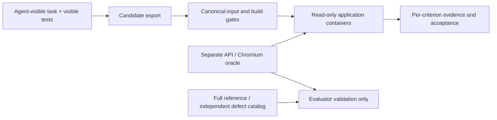

# Independent T01 acceptance evaluator

This supervisor-only evaluator checks the complete T01 target, separately from the public visible tests. It is not an agent harness and never launches a model. The hand-written full reference and defect catalog live here, outside the canonical starter and every exported task bundle. The earlier `benchmarks/T01/validation/visible-reference.*` files remain a visible-test witness only.

## Run

From the research repository, using Docker and Python 3.10+:

```sh
python3 -B evaluators/T01/evaluate.py --build \
  --candidate /absolute/path/to/candidate \
  --output /tmp/t01-acceptance-attempt

python3 -B evaluators/T01/verify.py --build \
  --output /tmp/t01-acceptance-validation

python3 -B scripts/tests/test_t01_acceptance_evaluator.py
```

Outputs must be new directories outside the candidate. The evaluator builds fixed application images and a separate pinned Playwright/Chromium image. Builds download dependencies; candidate/evaluator execution uses an internal-only network with no host ports, credentials, Docker socket or internet access. Image IDs/platforms, browser version, evaluator digest, fixture digest, projected application file hashes, command logs and criterion outcomes are recorded.

`--only A04 U09` runs selected diagnostics. It always returns `full_target_acceptance: null`; a partial pass cannot become an acceptance score. CLI exit codes: 0 for passing evaluated checks, 1 for candidate rejection, 2 for evaluator failure.

## Trust boundaries and independence

- The only shared code with the visible-test system is trusted source projection/infrastructure. The functional API and browser assertions do not import or execute visible tests or the reference implementation.
- Candidate test files, fixtures, locks and infrastructure must match the canonical starter. Only declared application source is mounted into service images, read-only. Frontend files may be added/refactored under `web/src/`; the common build and visible tests still require compatibility with their existing imports, including `App.vue`. Fixed runtime dependencies/configuration and fixture data come from trusted images.
- The evaluator image contains its own assertions and receives its expected fixture in a separate read-only mount. Candidate services receive neither evaluator source, criteria, reference code, defect catalog nor evaluator logs. There is no judge-feedback repair loop.
- This separation is enforced by packaging and container mounts. Publication in the research repository is not a confidentiality guarantee: live runtime/network admission must prevent fetching research inputs, including via code-search tools. Agent bundle tests verify exclusion for all three prompt levels.
- Oracle and reference are separate implementations written from the same published contract. Their agreement and the mutation checks are validation evidence; no independent human audit is claimed.

## What is scored

`criteria.json` defines 23 critical automated criteria across R01–R13. API checks cover complete objects, ordering on the canonical fixture, every difficulty/status filter, AND composition, trimmed case-insensitive literal search, invalid/empty/repeated known keys, ignored unknown keys, all details, exact domain errors, stable data, health and read-only quest routes. Chromium checks cover real list/detail integration, labeled controls, focus reachability, keyboard Apply/quest activation, detail field values, filter/list preservation, loading/empty/error states, HTTP versus transport failures, and controlled out-of-order list/detail responses. Cancellation, version counters and serialized interactions are all valid ways to avoid stale results.

Two prerequisite gates protect canonical inputs and verify TypeScript/production build. A complete evaluation accepts only when both gates pass and all 23 criteria pass. The full denominator stays the same for P1/P2/P3. Per-criterion pass/fail evidence remains available; failed requirements are not relabeled as infrastructure success.

The exposure mapping is conservative and **draft**. Grouped criteria with partially disclosed behavior are not automatically fully communicated. `communicated_conformance` stays null until the actual prompt/starter/tool exposure map receives a separate audit. These automated acceptance outcomes are not a maintainability review, a performance benchmark, or a live-runtime admission decision.

## Distinguish outcomes

| Status | Meaning | Full-target result |
|---|---|---|
| `completed` | Expected observation set returned; individual criteria can fail | true/false for complete evaluation; null for subsets |
| `invalid_candidate` | Protected input changed, missing input or unsafe source | false; functional criteria not scored as zero |
| `candidate_build_failure` | Fixed production/type check rejected candidate source | false; functional criteria not run |
| `candidate_unavailable` | Services cannot become reachable within setup allowance | false; inspect candidate service logs |
| `evaluator_error` | Wrong judge image, incomplete observations, launch/cleanup failure or evaluator exception | null; not a candidate zero |

HTTP/browser assertions have finite timeouts for execution control, not a product latency target. A failed assertion includes its observed evidence. A killed host can still prevent final evidence export; this is not a durable distributed run controller.

## Validate the evaluator

The verifier requires two complete reference passes, acceptance of valid serialized-request and accessible-label strategies, a component-extraction refactor preserving public compatibility, visible-test success but full-target rejection of the older witness, build-error and evaluator-error controls, rejection of the unfinished starter and protected-test tampering, and detection of 28 separately specified defects. Each mutant is evaluated against its predeclared target criterion. Passing startup or unrelated test failures never counts as detecting that defect. Subset mutation runs remain diagnostics, not full-target scores.

The defect catalog covers malformed list objects, ordering, ignored filters, regex/incorrect search, OR composition, enum/repeated/unknown-key handling, incomplete details, wrong unknown-ID status, health, shared-data mutation, added quest writes, missing initial data or UI feedback/fields, filter reset, destructive detail errors, inaccessible Apply, ignored HTTP errors and stale list/detail responses. Assertions do not branch on mutation names or import that catalog.

The standalone GitHub workflow repeats this validation without provider secrets, retaining logs and reports for 30 days after publication. It has been added locally; hosted execution requires a subsequent commit/push.

## Coverage limits before a paid pilot

The immutable fixture contains no title ties or case-colliding titles, so ordering checks cannot distinguish those branches on the supplied data. Do not silently add a new hidden input dataset to make the target harder. Feedback checks establish nonempty accessible roles, not every wording choice. Broader/custom-widget accessibility and absence of dormant out-of-scope code need review. Finite tests do not prove correctness for every program/input. These limits appear in every report.

Freeze the evaluator version/image/platform, review the criterion/disclosure mapping and reference, define the infrastructure rerun policy and integrate accepted runtime accounting before authorizing a paid campaign. None of this work authorizes model calls.



## Local validation receipt

[Verification receipt](verification.json): 39 validation cases passed on 23 October 2026, including all 28 predeclared defects and complete reference acceptance. Full evidence remains under ignored `ci-acceptance-results/`. The shared projection regression also passed H0–H4 for P1. These are local results; hosted CI has not run for this change.
